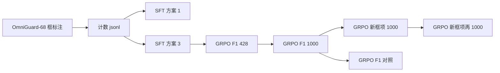

# Qwen3.8-TVP

在 **Qwen3.8-27B** 上用 LoRA 做 **OmniGuard-68** 航拍计数。模型按 Thinking-with-Visual-Primitives 的方式作答：思考里用 `<|ref|>` 和 `<|box|>` 标出实例，`</think>` 之后只留一个整数。

本仓库是训练代码、两种框奖励，以及验证集对比。权重、原图和完整 jsonl 不在这里。英文版见 [README_EN.md](README_EN.md)。

**结论：** 同样从方案 3 的 SFT 出发，F1 框奖励会让模型多画框来换召回；把框项换成 $(2n-N)/M$ 之后，多画的框被压回去。OmniGuard 验证集 20,878 条计数提问上，框 F1 从 **43.85%** 升到 **52.85%**，预测框从 78,848 降到 48,613，计数 MAE 从 1.428 降到 1.218。只训练语言模型的方案 1，和再打开 merger、视觉塔最后 8 层的方案 3，结果几乎一样。

## 验证集对比

协议：20,878 条计数提问（正负样本各 10,439），50,425 个真值框，贪心解码，`max_new_tokens=4096`，框按 IoU 0.5 贪心一对一匹配。小 / 中 / 大按原图像素面积划分：`<32²`、`32²–96²`、`≥96²`。分片原始结果在 `results/raw_metrics/`，汇总在 `results/omniguard_val_pooled.json`。用 `python scripts/pool_val_metrics.py` 可以从分片重算出下表的计数和框指标。

完全正确率会被空图抬高：空图准确率大约 93%–96%，有目标的图只有大约 50%。框指标和 MAE 更能看出模型是否真的在数。

| 方法 | 起点 | 完全正确 | MAE | 空图 | 有目标 | 框 P | 框 R | 框 F1 | 预测框 | 命中 |
| --- | --- | ---: | ---: | ---: | ---: | ---: | ---: | ---: | ---: | ---: |
| SFT 方案 1，只训 LLM | — | 72.79% | 1.512 | 95.61% | 49.98% | 39.92% | 43.61% | 41.68% | 55,097 | 21,992 |
| SFT 方案 3，LLM + merger + 视觉末 8 层 | — | 72.98% | 1.507 | **95.74%** | 50.23% | 39.87% | 44.01% | 41.84% | 55,658 | 22,190 |
| GRPO 428 步，框项 = F1 | 方案 3 | 72.72% | 1.485 | 93.54% | 51.90% | 34.79% | 50.18% | 41.09% | 72,723 | 25,303 |
| GRPO 1000 步，框项 = F1 | 方案 3 | 72.32% | 1.428 | 92.75% | **51.89%** | 35.94% | **56.20%** | 43.85% | 78,848 | **28,341** |
| GRPO 1000 步，框项 = $(2n-N)/M$ | F1 的 1000 步 | **73.12%** | **1.218** | 95.51% | 50.72% | **53.83%** | 51.90% | **52.85%** | **48,613** | 26,170 |

后三列里，F1 奖励的 1000 步命中最多，也画出最多框。新框项的预测框少于两个 SFT，召回仍高于 SFT，精确率高一截。匹配上的框彼此差不多紧：平均 IoU 都在 0.809–0.816，差的是画哪些框，不是框有多贴边。

F1 奖励的轨迹是单调的。428 步已经把预测框加到 7.3 万、空图准确率降到 93.5%；再训到 1000 步，召回继续升到 56.2%，精确率停在 36% 附近，空图准确率掉到 92.8%。这不是训练末尾的偶然抖动。

### 按目标大小

真值框：小 3,153，中 18,218，大 29,054。下表只覆盖三个已经做完尺寸统计的检查点。

| 尺寸 | 指标 | SFT 方案 3 | GRPO F1 1000 | GRPO 新框项 1000 |
| --- | --- | ---: | ---: | ---: |
| 小 | P / R / F1 | 16.82 / 18.52 / 17.63 | 13.72 / **38.03** / 20.17 | **35.53** / 33.33 / **34.40** |
| 中 | P / R / F1 | 26.37 / 28.36 / 27.33 | 30.40 / **52.16** / 38.41 | **47.25** / 46.57 / **46.91** |
| 大 | P / R / F1 | 50.44 / 56.58 / 53.34 | 45.41 / **60.71** / 51.96 | **60.05** / 57.25 / **58.62** |

小目标上，F1 奖励把召回从 18.5% 拉到 38.0%，精确率掉到 13.7%，F1 只多 2.5 个点。新框项把小目标 F1 做到 34.4%，大约是 SFT 的两倍，召回仍明显高于 SFT。中目标同样是精确率上来之后 F1 才拉开。大目标上 SFT 已经有 53% 的 F1，新框项再高大约 5 个点。

方案 1、方案 3、F1 的 428 步没有单独的尺寸 P/R，分片里只有小目标召回：17.60%、18.52%、35.01%。和上表同一方向。

### 还没跑完的实验

| 实验 | 状态 | 目前能看的数 |
| --- | --- | --- |
| `boxpen2`：新框项再训 1000 步 | 验证集 3 片里完成 2 片 | n=13,919，F1 56.28%，P 60.23%，MAE 1.170 |
| `f1cont`：从同一个 F1 1000 步起点、同一条 prompt 顺序，继续用旧 F1 训 1000 步 | 结果不在本仓库 | 有它之后，才能把 52.85% 的 F1 全部算到新公式上 |

`boxpen2` 的方向和新公式一致：框更少、精确率更高。它还不是全验证集数字，不能和上表直接比高低。

## 这些数字说明什么

1. **SFT 会数空图，不擅长画框。** 方案 3 的空图准确率 95.74%，有目标的图只有 50.23%，框 F1 41.84%。小目标 F1 17.63%。
2. **打开视觉塔，在这一轮 SFT 里几乎没有收益。** 方案 1 与方案 3 的超参、数据、训练步数相同，差别只在 LoRA 打在哪些层。完全正确率 72.79% 对 72.98%，框 F1 41.68% 对 41.84%，预测框 55,097 对 55,658。后面的 GRPO 都从方案 3 接着训。
3. **F1 当框奖励，模型会用多画框换命中。** 相对方案 3，1000 步 GRPO 的命中从 22,190 增到 28,341，预测框从 55,658 增到 78,848。精确率降到 35.94%，空图准确率降到 92.75%，过计从每图 0.37 增到 0.51。欠计从 1.14 降到 0.92。F1 对多余框太宽容：多一个不中的框只把分母加大。
4. **新框项把这个倾向倒过来。** 它从 F1 GRPO 的第 1000 步接着训 1000 步，prompt 顺序与旧实验的 seed 0 相同。预测框降到 48,613，低于 SFT；精确率 53.83%，F1 52.85%，MAE 1.218，过计 0.29。召回 51.90%，仍高于 SFT 的 44.01%。欠计停在 0.93，没有回到 SFT 的 1.14。空图准确率回到 95.51%。
5. **第 4 点还不是同起点的奖励消融。** 新框项多训了 1000 步，而且这 1000 步一开始重放了 F1 实验已经见过的前 2,568 张 rollout 图。同起点、同顺序、继续用 F1 的对照是 `f1cont`，本仓库没有它的验证结果。可以确定的是方向：新公式下框变少、精确率上升、召回从 F1 实验的高点回落，这和「一个没命中的框抵消一个命中」一致。
6. **新公式再往下训，有可能还涨。** `boxpen2` 在已完成的 13,919 条上 F1 56.28%、精确率 60.23%、MAE 1.170。等最后一片出来再当作全验证集结论。



## 奖励怎么比

`</think>` 后面不是一个裸整数时，整条奖励为 0。否则

$$
R = 0.3 + 0.4\exp\left(-\frac{(N-\mathrm{gt})^2}{2\sigma^2}\right) + 0.3\,S_{\mathrm{box}}
$$

$$
\sigma = \frac{0.3\,|\mathrm{gt}| + 0.1}{3}
$$

计数误差是对称的：真值是 1 时，预测 0 和预测 2 的计数项相同。框是百分数 xyxy，IoU 0.5 贪心一对一。$n$ 是匹配数，$N$ 是预测框数，$M$ 是真值框数。

| 框项 | 公式 | 参数 |
| --- | --- | --- |
| 旧，F1 | $S=2n/(N+M)$ | `--reward f1` |
| 新 | $S=(n-(N-n))/M=(2n-N)/M$ | `--reward score`，默认 |

空图且一个框都不画，$S=1$。其余情况只要有一边是空的，$S=0$。新分数可以是负数。推导和这一套 GRPO 损失（组内 z-score advantage，KL 参考始终钉在 SFT adapter 上，不是论文里的 clipped ratio）写在 [docs/REWARD.md](docs/REWARD.md)。

同一个真值 $M=2$ 上，两种分数差在多余框：

| 情形 | 匹配 $n$ | 预测 $N$ | F1 | 新分数 |
| --- | ---: | ---: | ---: | ---: |
| 两个都中 | 2 | 2 | 1.00 | 1.00 |
| 中两个，再多画一个不中的 | 2 | 3 | 0.80 | 0.50 |
| 只中一个，再多画五个不中的 | 1 | 6 | 0.25 | −2.00 |
| 空图，不画框 | — | 0 | 1 | 1 |

F1 在「中一个、空画五个」时仍有 0.25。新分数里，每一个没命中的框抵消一个命中，乱画会直接变成负分。框项只占奖励的 0.3，所以计数项仍然主导「答案是几」；表里完全正确率只从 72.32% 动到 73.12%，框的数量和质量变化大得多。

## 任务和训练

问的是一张航拍图里某一类有几个。监督只有框。OmniGuard 的 COCO `segmentation` 是空的。

数据在集群路径 `/data/wchen/data/OmniGuard-68`：训练 / 验证 41,401 / 4,597 张图，68 / 41 个类，像素 xywh 框。`tvp/build_omniguard_jsonl.py` 按「图 × 类别」展开成计数样本，正负样本 1:1，坐标写成 0–100 的百分数 xyxy。训练集 180,433 行，由 `random.Random(0)` 打乱。验证集就是上面的 20,878 行。单类框数超过 160 的行丢掉，避免答案被 `max_length` 截断。

SFT 一个 epoch，ZeRO-3，两张 NPU，全局 batch 相当于 16（`batch_size=1`，梯度累积 16），学习率 `1e-4`，LoRA $r=64$、$\alpha=128$、dropout 0.05。

| 方案 | 训练的模块 | 配置 |
| --- | --- | --- |
| 1 | LLM 的 attention、MLP、`lm_head` | `tvp/configs/lora_exp1_llm.yaml` |
| 3 | 方案 1，再加 merger 和视觉塔最后 8 个 block | `tvp/configs/lora_exp3_vision.yaml` |

GRPO 组大小 5。一张 NPU 专门采样，更新进程用 ZeRO-3。学习率 `1e-6`，KL 系数 0.04。参考策略固定为方案 3 的 `epoch_0_step_2819`，不随 GRPO 检查点更新。F1 实验从这份 SFT 训到 1000 步；新框项从那份 `step_1000` 再训 1000 步。集群上的卡号和端口见 [docs/SETUP.md](docs/SETUP.md)，完整表见 [docs/RESULTS.md](docs/RESULTS.md)。

## 复现

环境是昇腾 NPU 和 `torch_npu`，基座在 `$QWEN38_MODEL`，图像在 `$OMNIGUARD_ROOT`。特殊 token 的实现来自 `Thinking-with-Visual-Primitives-pytorch`，由 `tvp/tokens.py` 接入。只检查 jsonl 或指标时不需要这些包。

```bash
python tvp/build_omniguard_jsonl.py

torchrun --nproc_per_node=2 tvp/train.py \
  --config tvp/configs/lora_exp3_vision.yaml \
  --output_dir outputs/lora_exp3
```

新框项 GRPO 要从已经训好的策略接着跑。采样和更新分在不同卡上，集群启动脚本是 `scripts/run_grpo_boxpen.sh`。对应的本地命令：

```bash
python tvp/grpo_sample.py --ipc-dir "$OUT/ipc" --adapter "$POLICY"
torchrun --nproc_per_node=2 tvp/grpo_train.py \
  --adapter outputs/lora_exp3/epoch_0_step_2819 \
  --policy "$POLICY" \
  --reward score \
  --jsonl data/jsonl/train.jsonl \
  --image-root "$OMNIGUARD_ROOT" \
  --output-dir "$OUT" \
  --ipc-dir "$OUT/ipc" \
  --max-steps 1000
```

`--reward f1` 是旧框项。`--start-cursor` 和 `--start-seen` 用来续上 jsonl 指针。

贪心评测：

```bash
python sft_ship_lora/eval_lora_val.py \
  --adapter outputs/grpo_exp3_boxpen/step_1000 \
  --tag boxpen1000 \
  --jsonl path/to/val.jsonl \
  --image-root "$OMNIGUARD_ROOT" \
  --max-new-tokens 4096 \
  --out-dir eval_out
```

## 目录

```
tvp/                 SFT、GRPO、jsonl 构建
  configs/           方案 1 与方案 3 的 LoRA 配置
  eval/              集群上的验证启动脚本
sft_ship_lora/       奖励函数和 eval_lora_val.py
scripts/             容器启动脚本，以及分片汇总
results/             汇总 json 和原始分片
examples/            三条训练 jsonl 样例
docs/                奖励、完整结果表、集群备注
```

## 仓库里没有的东西

每个 LoRA adapter 大约 2 GB。训练集、验证集 jsonl、图像和逐条预测都不在这个仓库里。集群上的副本在 `model_train/Qwen3.8/TVP/outputs/` 和 `eval_omniguard*/`。

## 许可

代码使用 MIT。OmniGuard-68 和 Qwen 权重沿用它们原来的许可。
