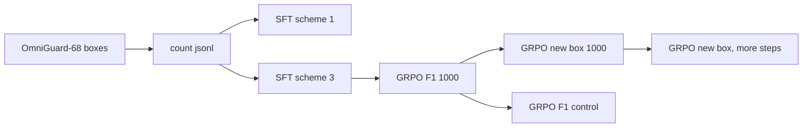

# Qwen3.8-TVP

LoRA SFT and GRPO for **Qwen3.8-27B** on **OmniGuard-68** aerial counting. The model answers in Thinking-with-Visual-Primitives tags (`<|ref|>`, `<|box|>`) and a bare integer after `</think>`.

This repository is the training stack, the two box-reward variants, and the OmniGuard validation comparison. Weights are not included. The Chinese write-up, which is the landing page, is [README.md](README.md).

**Result in one line:** under this recipe, LLM-only SFT and SFT with the merger plus the last 8 vision blocks are nearly tied. GRPO with an F1 box term then buys recall by drawing extra boxes. Replacing that term with $(2n-N)/M$ cuts the extras and lifts box F1 from 43.85% to 52.85% on 20,878 counting prompts. See [docs/RESULTS.md](docs/RESULTS.md).

## OmniGuard val (n = 20,878)

Half the prompts are empty (10,439 / 10,439), so exact-match accuracy sits near 73% while positive-image accuracy stays near 50%. Box F1 and count MAE are the metrics that move.

| Method | Start | Exact | MAE | Empty | Box P | Box R | Box F1 | Pred boxes |
| --- | --- | ---: | ---: | ---: | ---: | ---: | ---: | ---: |
| SFT scheme 1, LLM only | — | 72.79% | 1.512 | 95.61% | 39.92% | 43.61% | 41.68% | 55,097 |
| SFT scheme 3 | — | 72.98% | 1.507 | **95.74%** | 39.87% | 44.01% | 41.84% | 55,658 |
| GRPO 428, F1 box | scheme 3 | 72.72% | 1.485 | 93.54% | 34.79% | 50.18% | 41.09% | 72,723 |
| GRPO 1000, F1 box | scheme 3 | 72.32% | 1.428 | 92.75% | 35.94% | **56.20%** | 43.85% | 78,848 |
| GRPO 1000, new box | F1 step 1000 | **73.12%** | **1.218** | 95.51% | **53.83%** | 51.90% | **52.85%** | **48,613** |

The F1 run is already spraying boxes at step 428 (72,723 predictions, empty-image accuracy 93.54%). Another 572 steps push recall to 56.20% and empty-image accuracy down to 92.75%. The new term reverses that: fewer boxes than SFT, precision 53.83%, recall still above SFT.

New-reward GRPO starts from the F1 GRPO step-1000 adapter and retrains 1000 steps on the same seed-0 prompt order. A same-start F1 control (`f1cont`) is the proper ablation; that eval is not in this repo. A further 1000 new-reward steps (`boxpen2`) looks stronger on 2/3 of val (n=13,919, F1 56.28%, P 60.23%) and is not a full-set number.



## What this is

- **Task.** Count one requested class in an aerial image. Supervision is bbox-only. OmniGuard COCO `segmentation` fields are empty.
- **Data.** OmniGuard-68 train/valid at `/data/wchen/data/OmniGuard-68`: 41,401 / 4,597 images, 68 / 41 classes, pixel xywh boxes. `tvp/build_omniguard_jsonl.py` expands each image into per-class prompts with a 1:1 negative sample. Train jsonl: 180,433 rows. Val: 20,878 rows, 50,425 GT boxes.
- **SFT.** One epoch, ZeRO-3, two NPUs, LoRA r=64, α=128. Scheme 1 is LLM attention, MLP, and `lm_head`. Scheme 3 adds the merger and the last 8 vision blocks. On this val set those two checkpoints differ by 0.19 points of exact match and 0.16 points of box F1.
- **GRPO.** Group size 5. Sampler on a dedicated NPU, updater on ZeRO-3. KL targets the frozen SFT adapter `lora_exp3/epoch_0_step_2819`.

Reward (format + count Gaussian + box), details in [docs/REWARD.md](docs/REWARD.md):

$$
R=0.3+0.4\,e^{-(N-\mathrm{gt})^2/2\sigma^2}+0.3\,S_{\mathrm{box}},\quad \sigma=(0.3|\mathrm{gt}|+0.1)/3
$$

Old $S_{\mathrm{box}}=2n/(N+M)$. New $S_{\mathrm{box}}=(2n-N)/M$. One unmatched box cancels one true match, so the new term can go negative. F1 only grows the denominator.

## Layout

```
tvp/                 SFT + GRPO trainers, jsonl builders
  configs/           LoRA YAML (scheme 1 LLM-only, scheme 3 +vision)
  eval/              OmniGuard launch scripts
sft_ship_lora/       Reward functions and eval_lora_val.py
scripts/             docker launchers, plus pool_val_metrics.py
results/             pooled metrics + raw shard json
examples/            three train jsonl rows
docs/                reward math, full tables, cluster notes
```

## Setup

Cluster path: Qwen3.8-27B at `$QWEN38_MODEL`, images at `$OMNIGUARD_ROOT`, container `zzy-ship-sft` with Ascend + `torch_npu`. TVP special-token code is imported from `Thinking-with-Visual-Primitives-pytorch`.

```bash
python tvp/build_omniguard_jsonl.py

torchrun --nproc_per_node=2 tvp/train.py \
  --config tvp/configs/lora_exp3_vision.yaml \
  --output_dir outputs/lora_exp3
```

GRPO with the new box term, starting from an existing policy. The cluster wrapper is `scripts/run_grpo_boxpen.sh`.

```bash
python tvp/grpo_sample.py --ipc-dir "$OUT/ipc" --adapter "$POLICY"
torchrun --nproc_per_node=2 tvp/grpo_train.py \
  --adapter outputs/lora_exp3/epoch_0_step_2819 \
  --policy "$POLICY" \
  --reward score \
  --jsonl data/jsonl/train.jsonl \
  --image-root "$OMNIGUARD_ROOT" \
  --output-dir "$OUT" \
  --ipc-dir "$OUT/ipc" \
  --max-steps 1000
```

`--reward f1` is the old box term. `--start-cursor` / `--start-seen` resume the jsonl pointer.

```bash
python sft_ship_lora/eval_lora_val.py \
  --adapter outputs/grpo_exp3_boxpen/step_1000 \
  --tag boxpen1000 \
  --jsonl path/to/val.jsonl \
  --image-root "$OMNIGUARD_ROOT" \
  --max-new-tokens 4096 \
  --out-dir eval_out
```

## Not in this repo

LoRA adapters (~2 GB each), train/val jsonl, images, and prediction dumps. Cluster copies live under `model_train/Qwen3.8/TVP/outputs/` and `eval_omniguard*/`.

## License

MIT. OmniGuard-68 and Qwen weights keep their original licenses.
