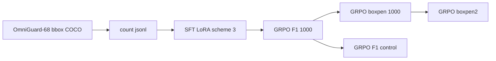

# Qwen3.8-TVP

LoRA SFT and GRPO for **Qwen3.8-27B** on **OmniGuard-68** aerial counting. The model answers in Thinking-with-Visual-Primitives tags (`<|ref|>`, `<|box|>`) and a bare integer after `</think>`.

This repository is the TVP training stack, the two box-reward variants, and the OmniGuard validation comparison. Weights are not included.

**Result in one line:** swapping the GRPO box term from F1 to \((2n-N)/M\) cuts extra boxes and lifts box F1 from 43.85% to 52.85% on OmniGuard val (20,878 images). See [docs/RESULTS.md](docs/RESULTS.md).

## OmniGuard val (n = 20,878)

| Method | Exact | MAE | Box P | Box R | Box F1 | Pred boxes |
| --- | ---: | ---: | ---: | ---: | ---: | ---: |
| SFT scheme 3 | 72.98% | 1.51 | 39.87% | 44.01% | 41.84% | 55,658 |
| GRPO 1000, F1 box | 72.32% | 1.43 | 35.94% | **56.20%** | 43.85% | 78,848 |
| GRPO 1000, new box | **73.12%** | **1.22** | **53.83%** | 51.90% | **52.85%** | **48,613** |

New-reward GRPO starts from the F1 GRPO step-1000 adapter and retrains 1000 steps on the same seed-0 prompt order. A same-start F1 control (`f1cont`) is the proper ablation; that eval is not finished. A further 1000 new-reward steps (`boxpen2`) looks stronger on 2/3 of val (F1 56.3%) but is not a full-set number yet.



## What this is

- **Task.** Count one requested class in an aerial image. Supervision is bbox-only. OmniGuard COCO `segmentation` fields are empty.
- **Data.** OmniGuard-68 train/valid (host path `/data/wchen/data/OmniGuard-68`, same files as `MYVLLM/dataset/OmniGuard-68`): 41,401 / 4,597 images, 68 / 41 classes, pixel xywh boxes, no masks. Prompts: 180,433 train jsonl rows.
- **SFT.** Scheme 3 LoRA: r=64, α=128, LLM attn+MLP+lm_head, merger, last 8 vision layers. One epoch, ZeRO-3, two NPUs.
- **GRPO.** Group size 5, sampler on a dedicated NPU, updater ZeRO-3. KL to the frozen SFT adapter.

Reward (format + count Gaussian + box). Details in [docs/REWARD.md](docs/REWARD.md):

\[
R=0.3+0.4\,e^{-(N-\mathrm{gt})^2/2\sigma^2}+0.3\,S_{\mathrm{box}},\quad \sigma=(0.3|\mathrm{gt}|+0.1)/3
\]

Old \(S_{\mathrm{box}}=2n/(N+M)\). New \(S_{\mathrm{box}}=(2n-N)/M\).

## Layout

```
tvp/                 SFT + GRPO trainers, jsonl builders
  configs/           LoRA YAML (scheme 1 LLM-only, scheme 3 +vision)
  eval/              OmniGuard launch scripts
sft_ship_lora/       Reward functions and eval_lora_val.py
scripts/             docker launchers used on the cluster
results/             pooled metrics + raw shard json
examples/            three train jsonl rows
docs/                reward math and full tables
```

## Setup

Cluster path: Qwen3.8-27B at `$QWEN38_MODEL`, images at `$OMNIGUARD_ROOT`, container `zzy-ship-sft` with Ascend + `torch_npu`. TVP special-token code is imported from `Thinking-with-Visual-Primitives-pytorch`.

Build counting jsonl from COCO:

```bash
python tvp/build_omniguard_jsonl.py
```

SFT (scheme 3):

```bash
torchrun --nproc_per_node=2 tvp/train.py \
  --config tvp/configs/lora_exp3_vision.yaml \
  --output_dir outputs/lora_exp3
```

GRPO with the new box term, starting from an existing policy:

```bash
# sampler on one card, updater on two — see scripts/run_grpo_boxpen.sh
python tvp/grpo_sample.py --ipc-dir "$OUT/ipc" --adapter "$POLICY"
torchrun --nproc_per_node=2 tvp/grpo_train.py \
  --adapter outputs/lora_exp3/epoch_0_step_2819 \
  --policy "$POLICY" \
  --reward score \
  --jsonl data/jsonl/train.jsonl \
  --image-root "$OMNIGUARD_ROOT" \
  --output-dir "$OUT" \
  --ipc-dir "$OUT/ipc" \
  --max-steps 1000
```

`--reward f1` is the old box term. `--start-cursor` / `--start-seen` resume the jsonl pointer.

Eval (greedy, 4096 new tokens):

```bash
python sft_ship_lora/eval_lora_val.py \
  --adapter outputs/grpo_exp3_boxpen/step_1000 \
  --tag boxpen1000 \
  --jsonl path/to/val.jsonl \
  --image-root "$OMNIGUARD_ROOT" \
  --max-new-tokens 4096 \
  --out-dir eval_out
```

## Conclusions

1. **SFT already counts empty images well** (95.7%) and is weak on boxes (F1 41.8%), especially small objects (F1 17.6%).
2. **F1-box GRPO recalls more true boxes** (28.3k vs 22.2k) by drawing far more boxes (78.8k). Precision drops. Empty-image accuracy falls to 92.8%. F1 of extra boxes is too weak a penalty.
3. **The new box score reverses that.** Predicted boxes fall below SFT (48.6k), precision jumps to 53.8%, F1 to 52.9%, MAE to 1.22. Recall stays above SFT. Small-object F1 almost doubles vs SFT (34.4%).
4. **Do not treat (3) as a clean reward ablation** until `f1cont` finishes: boxpen was trained on top of F1 GRPO 1000. Prompt-order logs confirm boxpen replayed the same first 2,568 images the F1 run had already used.
5. **More new-reward steps may still help.** Partial boxpen2 val (13,919 / 20,878) is at F1 56.3%, P 60.2%. Wait for the last shard.

## Not in this repo

LoRA adapters (~2 GB each), train/val jsonl, images, and prediction dumps. Cluster copies live under `model_train/Qwen3.8/TVP/outputs/` and `eval_omniguard*/`.

## License

MIT. OmniGuard-68 and Qwen weights keep their original licenses.
